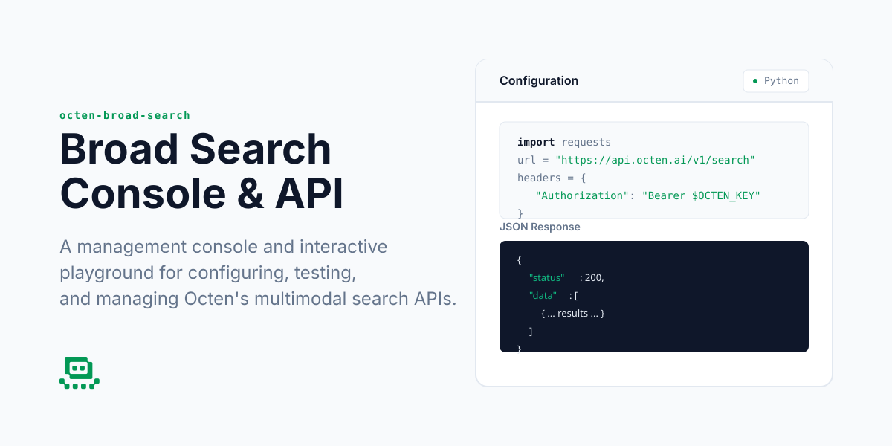

<p align="center">
  
</p>

Octen Broad Search is an interactive console and management interface designed for configuring, testing, and monitoring multimodal search APIs.

## Why it is different

Most API management tools decouple configuration from execution. Broad Search connects them directly: adjusting domain filters, safesearch, or maximum sub-queries in the interface instantly updates the generated request payload. This allows you to evaluate search quality across modalities (web, image, video) in real time without writing boilerplate code.

## How it works

1. **Configuration**: Set queries, max results, time bases, and domain inclusions via the UI.
2. **Code Generation**: The console automatically produces equivalent `Python`, `JavaScript`, and `cURL` snippets.
3. **Execution & Evaluation**: Requests are executed directly from the browser, with the response rendered in an interactive JSON viewer.
4. **Management**: Organization owners can manage API keys, track cross-member usage, and set usage limits per key.

## Local Development

To run the console locally:

```bash
# Clone the repository
git clone https://github.com/octen-ai/octen-broad-search.git
cd octen-broad-search

# The console is a static HTML/JS application built with Tailwind CSS.
# You can use any static server to preview it.
npx serve .
```

Navigate to `http://localhost:3000` to interact with the interface.

## Project Structure

- `index.html` — The main console application, containing the layout, modal structures, and core UI elements.
- `css/styles.css` — Custom styling augmenting Tailwind.
- `js/broad-search-api.js` — Logic for the interactive API playground, payload generation, and JSON rendering.
- `js/syntax-highlight.js` — Syntax highlighting for generated code snippets.
- `js/core/sidebar.js` — Modular sidebar integration using `OctenSidebar` component supporting Plan A & Plan B switching with persistent state in `localStorage` (`octen-sidebar-plan`).
- `js/pages/overview/template.js` — Overview dashboard featuring the 6 capability panels (Search Ultra Fast, Search Fast, Search Premier, Models, Tools, Application) matching `https://octen.ai/platform/overview`.
- `octen-sidebar/` — Sidebar design engineering suite supporting two Search category navigation layouts:
  - **Plan A (Default)**: Bento dual-card layout separating `FAST` and `PREMIER` search endpoints.
  - **Plan B**: Directory hierarchy tree structure with rounded 90° connection lines (`border-bottom-left-radius: 8px`) dropping from an elevated `Search` parent card with a status dot indicator (matching user reference mockup).
  - **Switching**: Switchable on the fly via the Search category header badge `[A | B]`, the user popover's `Sidebar Plan` segmented control, or programmatically with `window.setSidebarPlan('a' | 'b')` / `window.toggleSidebarPlan()`.
  - **Strict Scope Boundary**: Plan switching strictly affects only the Search category; all other sections (Overview, Models, Tools, Application, Management, Org switcher, User footer) remain consistent.

## License

Internal proprietary software. All rights reserved.
